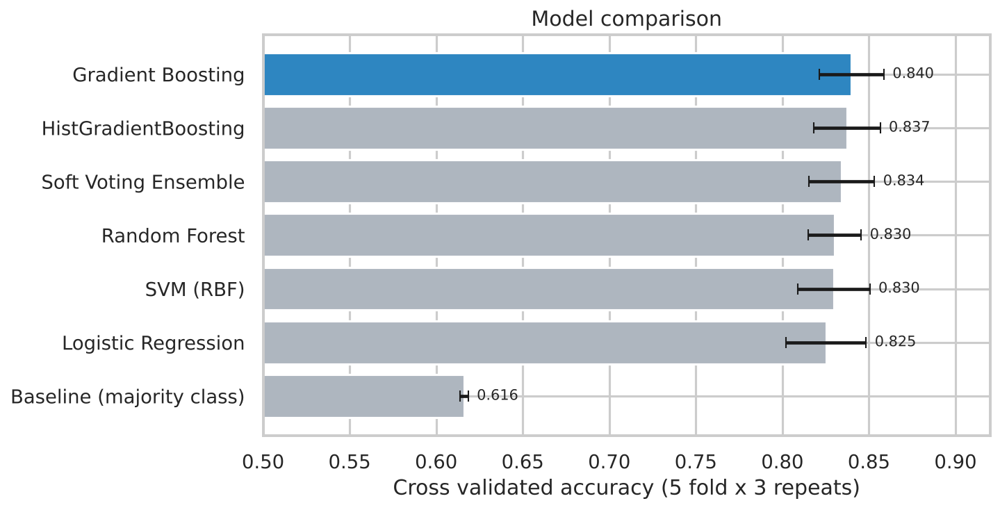
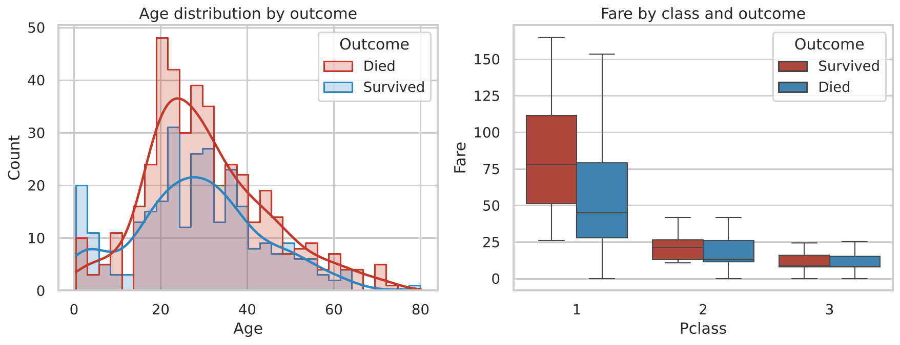
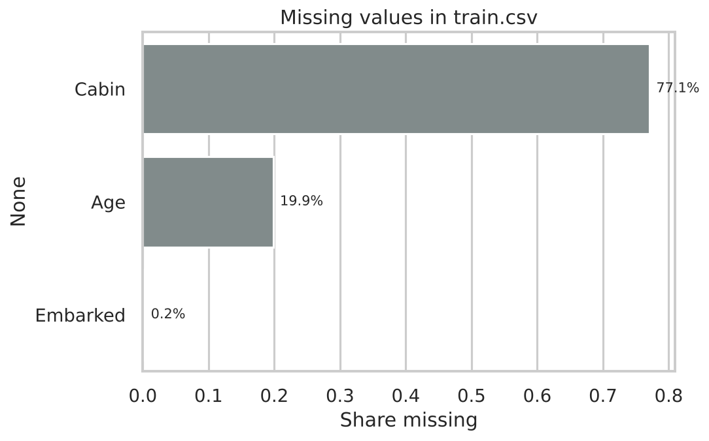
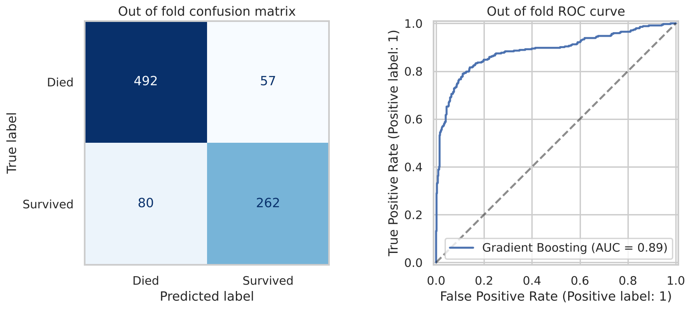
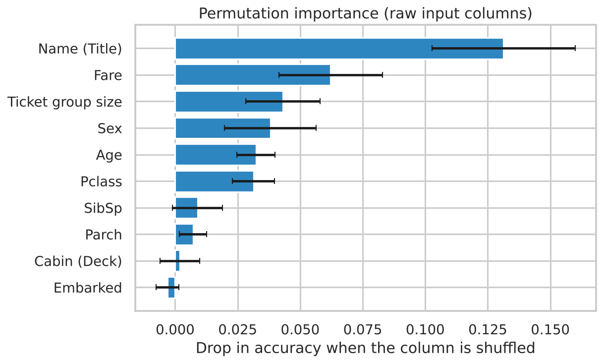

# Titanic Survival Prediction: an end to end, production style ML pipeline

[](https://github.com/1rupiah/Titanic---Machine-Learning-from-Disaster/actions/workflows/ci.yml)


[](https://www.kaggle.com/c/titanic)

Binary classification model that predicts whether a passenger survived the Titanic,
built for the Kaggle competition
[Titanic: Machine Learning from Disaster](https://www.kaggle.com/c/titanic).

The goal of this repository is not only a leaderboard score. It demonstrates the way a
model should be built in a real company: honest baselines, leakage safe validation,
reproducible training, automated tests, and results that a non technical stakeholder
can understand.

---

## TL;DR

| | Accuracy | Notes |
|---|---|---|
| Baseline: predict "everyone died" | **61.6%** | Majority class |
| Baseline: "all women survive" rule | **78.7%** | Strong domain heuristic |
| **Final model: Gradient Boosting** | **84.0% ± 1.9%** | 5 fold x 3 repeat stratified CV, ROC AUC 0.88 |
| Kaggle public leaderboard | _fill in after submitting_ | Scored on 50% of the hidden test set |

**Headline result:** the model makes about **25% fewer mistakes** than the best simple
rule and **58% fewer mistakes** than the naive baseline.



---

## 1. Problem framing

| Item | Detail |
|---|---|
| Task | Supervised binary classification (`Survived`: 1 or 0) |
| Data | 891 labelled passengers (train), 418 unlabelled passengers (test) |
| Metric | Accuracy (competition metric), with ROC AUC, F1, precision and recall tracked as secondary metrics |
| Class balance | 38.4% survived, 61.6% died |
| Deliverable | `submissions/submission.csv` with exactly 418 rows and columns `PassengerId,Survived` |

## 2. What the data says


Key findings from the exploratory analysis:

1. **Sex is the strongest single signal.** 74% of women survived versus 19% of men,
   consistent with the "women and children first" evacuation policy.
2. **Socioeconomic status matters.** First class passengers survived at 63%, third class
   at only 24%.
3. **Title captures sex, age and status at once.** "Master" (boys) survived at 57% while
   adult men ("Mr") survived at 16%, so the title extracted from the name is more
   informative than sex alone.
4. **Travelling group size is non linear.** Solo travellers and very large families both
   fared worse than small families.



Data quality issues handled in the pipeline:



| Column | Missing | Strategy |
|---|---|---|
| `Cabin` | 77% | Converted into `Deck` (letter) and `HasCabin` flag instead of being dropped |
| `Age` | 20% | Median age **per title**, learned on training folds only |
| `Embarked` | 0.2% | Most frequent port, learned on training folds only |
| `Fare` (test) | 1 row | Median fare of the passenger class |

## 3. Feature engineering

| Feature | Source | Why it helps |
|---|---|---|
| `Title` | `Name` | Encodes sex, age group and social status in one variable |
| `FamilySize`, `IsAlone`, `FamilyType` | `SibSp`, `Parch` | Captures the non linear effect of group size |
| `TicketGroupSize` | `Ticket` | Passengers sharing a ticket (friends, servants, families) tended to share a fate |
| `FarePerPerson` | `Fare`, `TicketGroupSize` | Fares were paid per ticket, so this is a cleaner wealth signal |
| `Deck`, `HasCabin` | `Cabin` | Proxy for location on the ship and for record keeping by class |
| `IsChild` | `Age` | Makes the "children first" rule explicit |

All transformations live inside a single scikit learn `Pipeline`
(`FeatureEngineer` → `ColumnTransformer` → model). This means imputation values and
scaling are re fitted inside every cross validation fold, so no statistics from the
validation data leak into training. `TicketGroupSize` is computed on the combined
passenger list, which uses no target information.

## 4. Modelling and validation

Six candidate models were compared with **repeated stratified 5 fold cross validation
(3 repeats, 15 fits per model)**, which gives a far more stable estimate than a single
train/test split on a dataset this small.

| Model | CV accuracy | ROC AUC | F1 |
|---|---|---|---|
| Baseline (majority class) | 0.616 ± 0.002 | 0.500 | 0.000 |
| Logistic Regression | 0.825 ± 0.023 | 0.874 | 0.767 |
| SVM (RBF) | 0.830 ± 0.021 | 0.871 | 0.769 |
| Random Forest | 0.830 ± 0.015 | 0.872 | 0.767 |
| HistGradientBoosting | 0.837 ± 0.019 | 0.870 | 0.778 |
| Soft Voting Ensemble | 0.834 ± 0.019 | 0.882 | 0.777 |
| **Gradient Boosting (selected)** | **0.840 ± 0.019** | **0.881** | **0.782** |

The full table with precision, recall and training time is in
[`reports/model_comparison.csv`](reports/model_comparison.csv), and every number in this
README is generated automatically into [`reports/metrics.json`](reports/metrics.json).

### Error analysis (out of fold predictions)



On predictions made for passengers the model had not seen during training:

* **Precision 82%**: when the model says "survived", it is right 4 out of 5 times.
* **Recall 77%**: it finds about 3 out of 4 actual survivors.
* Most errors are **survivors predicted as deaths** (80 cases), typically adult men in
  lower classes who survived against the odds. This is the hardest segment to predict.

### What drives the predictions



Permutation importance (how much accuracy drops when a column is shuffled) confirms the
model learned sensible, explainable patterns: **title, fare, travelling group size, sex,
age and class**. Embarkation port adds no value, which is expected since it only acts as
a proxy for class.

### Decision threshold


The competition rewards accuracy, so a 0.5 threshold is used. In a business setting the
threshold would be tuned to the cost of each error type (see section 6).

## 5. Engineering practices

| Practice | Implementation |
|---|---|
| Reproducibility | Fixed random seeds, single command training, pinned dependency ranges |
| No data leakage | Every learned statistic is fitted inside the CV pipeline |
| Honest evaluation | Two baselines, repeated CV with standard deviations, out of fold diagnostics |
| Contract validation | `predict.py` refuses to write a submission that breaks the Kaggle format (columns, 418 rows, binary values, matching IDs) |
| Automated tests | 11 `pytest` tests covering features, leakage, submission format and a regression check that the model beats the baseline |
| CI | GitHub Actions runs linting (`ruff`) and tests on every push |
| Modular code | `src/` package layout, configuration in one file, no notebook only logic |

## 6. Business impact: what this means outside Kaggle

The Titanic dataset is a teaching problem, but the workflow is exactly the one used for
high value classification problems in industry:

| Industry use case | "Survived" becomes | Equivalent of the features used here |
|---|---|---|
| Customer churn (telco, banking, SaaS) | Customer stays or leaves | Tenure, plan tier, household size, spend |
| Credit risk | Loan repaid or defaulted | Income band, existing obligations, demographics |
| Insurance claims triage | Claim legitimate or suspicious | Policy class, claim amount, claimant history |
| Healthcare readmission | Patient readmitted or not | Age, admission type, comorbidities |
| Marketing response | Customer converts or not | Segment, past purchases, channel |

**Illustrative impact.** Suppose a retention team scores 100,000 customers per month.
Moving from a simple business rule (78.7% accuracy) to this model (84.0%) reduces wrong
decisions from about 21,300 to about 16,000, which is **around 5,300 fewer customers who
are either missed or contacted unnecessarily, every month**. With an average contact
cost or lost customer value attached, that difference becomes a direct budget figure.
(These numbers are a worked example, not measured results.)

Beyond accuracy, the parts that matter most to an employer are the ones that make a
model safe to ship:

* **Baselines first** prevent shipping a complex model that does not beat a simple rule.
* **Leakage safe pipelines** make offline accuracy a trustworthy forecast of live accuracy.
* **Explainability** (permutation importance) lets the model be defended to managers,
  auditors and regulators.
* **Threshold tuning** turns a probability into a decision aligned with business costs,
  for example favouring recall when missing a churner costs more than an extra phone call.
* **Validated outputs, tests and CI** stop silent failures from reaching production.

## 7. Project structure

```
.
├── .github/workflows/ci.yml    # Lint and test on every push
├── data/
│   ├── README.md               # How to obtain the Kaggle data
│   └── raw/                    # train.csv, test.csv (git ignored)
├── reports/
│   ├── figures/                # All charts used in this README
│   ├── metrics.json            # Machine readable results
│   ├── model_comparison.csv
│   └── MODEL_CARD.md           # Intended use, metrics, limitations
├── src/titanic/
│   ├── config.py               # Paths, seeds, feature lists
│   ├── data.py                 # Loading and schema validation
│   ├── features.py             # Feature engineering transformer
│   ├── models.py               # Candidate pipelines
│   ├── train.py                # CV comparison, selection, artifacts
│   ├── predict.py              # Submission generation and validation
│   └── plots.py                # Report figures
├── submissions/submission.csv  # File uploaded to Kaggle
├── tests/                      # pytest suite
├── pyproject.toml
└── requirements.txt
```

## 8. How to reproduce

```bash
git clone https://github.com/1rupiah/Titanic---Machine-Learning-from-Disaster.git
cd Titanic---Machine-Learning-from-Disaster

python -m venv .venv
# Windows: .venv\Scripts\activate    macOS/Linux: source .venv/bin/activate
pip install -e ".[dev]"

# put train.csv and test.csv in data/raw/ (see data/README.md)
python -m titanic.train      # compares models, saves model, metrics and figures
python -m titanic.predict    # writes submissions/submission.csv
pytest -q                    # runs the test suite
```

Submit through the Kaggle website or CLI:

```bash
kaggle competitions submit -c titanic -f submissions/submission.csv -m "Gradient Boosting pipeline v1.0"
```

## 9. Limitations and next steps

* **Small dataset.** With 891 rows, differences of under 1 point between models are
  within noise; the standard deviations in the table should be read alongside the means.
* **CV versus leaderboard gap.** Kaggle Titanic scores are typically a few points below
  cross validation because the test set is small and has a slightly different
  distribution. The CV estimate is the more reliable measure of generalisation.
* **Model selection bias.** Picking the best of six models by CV slightly inflates the
  winning score; nested cross validation would remove this.
* **Next steps:** hyperparameter search with nested CV, family survival features
  (surname plus ticket groups), probability calibration, and SHAP based explanations.

## Author

**1rupiah** · [GitHub](https://github.com/1rupiah)

Data: Kaggle, *Titanic: Machine Learning from Disaster*. Code released under the MIT License.
