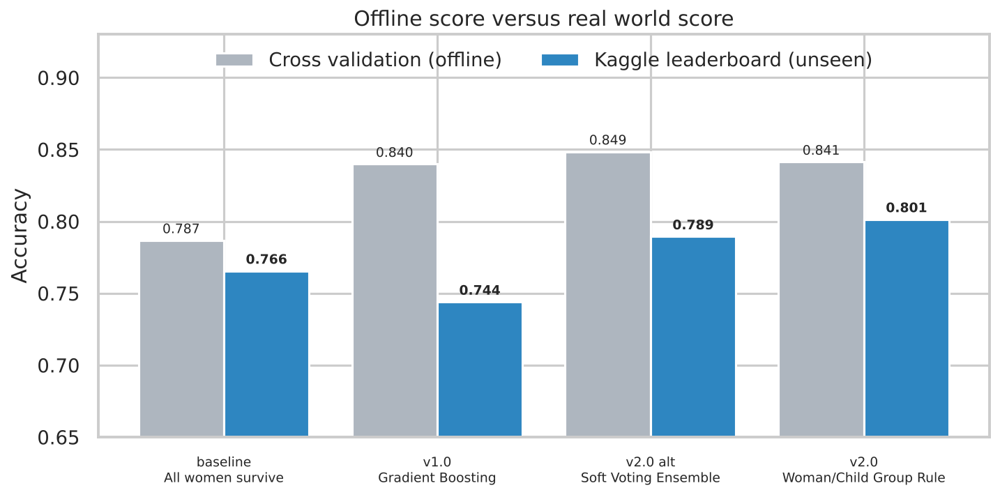
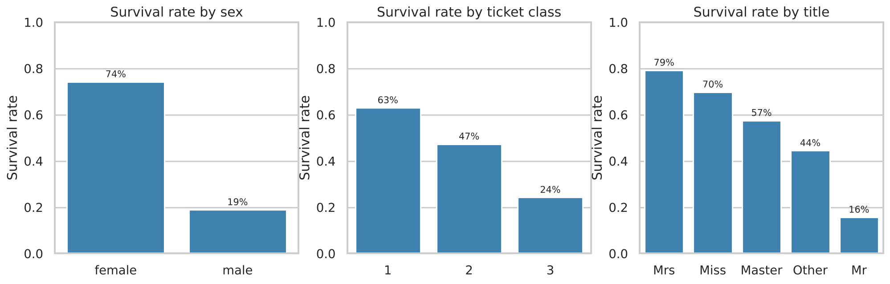
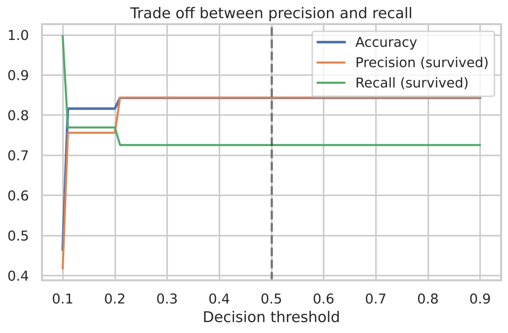

# Titanic Survival Prediction: an end to end, production style ML pipeline


[](https://www.kaggle.com/c/titanic)

Binary classification model that predicts whether a passenger survived the Titanic,
built for the Kaggle competition
[Titanic: Machine Learning from Disaster](https://www.kaggle.com/c/titanic).

This repository is not only about a leaderboard score. It shows how a model should be
built and **debugged** in a real company: honest baselines, leakage safe validation, a
documented failure, the fix, automated tests, and results a non technical stakeholder
can follow.

---

## TL;DR

| Version | Model | CV accuracy | Kaggle leaderboard | Correct (of 418) |
|---|---|---|---|---|
| Baseline | "All women survive" rule | 78.7% | 0.76555 | 320 |
| v1.0 | Gradient Boosting, 16 features | 84.0% | 0.74401 ❌ | 311 |
| v2.0 alt | Soft Voting Ensemble (highest CV) | **84.9%** | 0.78947 | 330 |
| **v2.0** | **Woman/Child Group Rule (selected)** | 84.1% | **0.80143** ✅ | **335** |

**Headline results**

* v2.0 scores **0.80143**, which is **24 more passengers predicted correctly than v1**
  and 15 more than the baseline rule.
* The model with the **highest CV score did not win** on unseen data. The simpler model,
  chosen by an explicit selection rule written *before* seeing the leaderboard, did.
* The v1 failure (84% offline, 74% on unseen data) is kept and analysed in section 5.
  A model that looks great offline and disappoints in production is one of the most
  common and expensive failures in industry ML.




---

## 1. Problem framing

| Item | Detail |
|---|---|
| Task | Supervised binary classification (`Survived`: 1 or 0) |
| Data | 891 labelled passengers (train), 418 unlabelled passengers (test) |
| Metric | Accuracy (competition metric); ROC AUC, F1, precision and recall tracked as secondary metrics |
| Class balance | 38.4% survived, 61.6% died |
| Deliverable | `submissions/submission.csv` with exactly 418 rows and columns `PassengerId,Survived` |

## 2. What the data says



1. **Sex is the strongest single signal.** 74% of women survived versus 19% of men,
   consistent with the "women and children first" evacuation policy.
2. **Socioeconomic status matters.** First class survived at 63%, third class at 24%.
3. **Title captures sex, age and status at once.** Boys ("Master") survived at 57% while
   adult men ("Mr") survived at 16%.
4. **Families shared a fate.** Women and children travelling together usually either all
   survived or all died. This turned out to be the key insight for v2.


| Column | Missing | Strategy |
|---|---|---|
| `Cabin` | 77% | Converted into `Deck` and a `HasCabin` flag instead of being dropped |
| `Age` | 20% | Median age **per title**, learned on training folds only |
| `Embarked` | 0.2% | Most frequent port, learned on training folds only |
| `Fare` (test) | 1 row | Median fare of the passenger class |

## 3. Feature engineering

| Feature | Source | Why it helps |
|---|---|---|
| `Title` | `Name` | Encodes sex, age group and social status in one variable |
| `FamilySize`, `IsAlone`, `FamilyType` | `SibSp`, `Parch` | Non linear effect of group size |
| `TicketGroupSize`, `FarePerPerson` | `Ticket`, `Fare` | Fares were paid per ticket; shared tickets reveal travel groups |
| `Deck`, `HasCabin` | `Cabin` | Location on the ship and record keeping by class |
| `IsChild`, `IsWomanOrChild` | `Age`, `Title` | Makes "women and children first" explicit |
| **`WCGroupRate`, `WCGroupKnown`** (v2) | Surname, ticket, fare, port | Survival rate of the *other* women and children in the passenger's travel group |

`WCGroupRate` uses training labels, so it is built with the same care as target
encoding in production systems:

* It is learned inside the pipeline, so in cross validation it only sees labels from
  the training folds.
* On training rows it is **leave one out**: a passenger never sees their own label.
* Travel groups are identified by two keys (surname + class + ticket stem + fare + port,
  and identical ticket number), which separates unrelated people who share a surname.

All steps live in one scikit learn `Pipeline` (`FeatureEngineer` → `ColumnTransformer` →
model), and there are unit tests that prove the leave one out behaviour.

## 4. Modelling and validation

Eight candidates were compared with **repeated stratified 5 fold cross validation
(3 repeats, 15 fits per model)**:

| Model | CV accuracy | ROC AUC | Precision | Recall |
|---|---|---|---|---|
| Baseline (majority class) | 0.616 ± 0.002 | 0.500 | n/a | 0.000 |
| **Woman/Child Group Rule (selected)** | **0.841 ± 0.026** | 0.854 | **0.843** | 0.721 |
| Logistic Regression | 0.843 ± 0.021 | 0.900 | 0.811 | 0.772 |
| SVM (RBF) | 0.845 ± 0.024 | 0.886 | 0.834 | 0.747 |
| Random Forest | 0.840 ± 0.020 | 0.888 | 0.828 | 0.739 |
| HistGradientBoosting | 0.844 ± 0.020 | 0.886 | 0.822 | 0.760 |
| Gradient Boosting | 0.846 ± 0.027 | 0.896 | 0.818 | 0.771 |
| Soft Voting Ensemble | 0.849 ± 0.022 | 0.901 | 0.829 | 0.763 |

Every model sits between 84% and 85%, and every gap is smaller than one standard
deviation. **CV cannot tell these models apart.** So v2 uses an explicit selection rule.

### Selection rule: simplest model within one standard error

The selected model is the **simplest model whose CV accuracy is within one standard
deviation of the best**. This is a standard technique (the "one standard error rule"
from *The Elements of Statistical Learning*) and it is implemented in code, not chosen by
hand, in `train.py::select_one_std_rule`.

The winner is a transparent rule with **zero learned parameters**:

* Women survive, **unless** every other woman/child in their travel group died.
* Men die, **except** boys whose group's women/children all survived.

On the test set it changes 17 predictions compared with the plain gender rule
(9 women predicted to die, 8 boys predicted to survive), and each change can be traced
to a specific family. Those 17 changes produced a net gain of 15 correct passengers on
the leaderboard (320 to 335), so the large majority of the family based corrections were
right.

The highest CV model (Soft Voting Ensemble) was exported as
`submissions/submission_best_cv.csv` and submitted as a controlled comparison. It scored
0.78947, five passengers worse than the rule, **confirming the selection rule** rather
than just asserting it.

### Error analysis and drivers


Out of fold, the rule is right **84% of the time it predicts "survived"** (precision),
the highest of all models, and the main remaining error is adult men who survived
against the odds, a group with almost no signal in the data.


Sex and travel group (ticket and surname) carry essentially all of the signal. Age,
fare and cabin add nothing once family outcomes are known.



## 5. Post mortem: why v1 failed on Kaggle

| | v1.0 | v2.0 |
|---|---|---|
| Model | Gradient Boosting, 300 trees | Rule with zero learned parameters |
| CV accuracy | 84.0% | 84.1% |
| Kaggle leaderboard | 0.74401 (311 / 418) | **0.80143 (335 / 418)** |
| Gap between CV and real world | 9.6 points | 4.0 points |
| Selection | Highest CV score | Simplest model within one std of the best |

**Root causes**

1. **Selecting on noise.** With 891 rows, a 1 point CV difference is about 9 passengers.
   Picking "the highest number" among models that are statistically tied rewards
   whichever one happened to fit the folds best.
2. **Too much capacity for the signal available.** 300 trees on 16 correlated features
   learned patterns specific to the training passengers (exact fares, cabin letters,
   ages) that do not transfer.
3. **Distribution shift.** The test passengers are not a perfectly random sample of the
   same distribution, and flexible models are the most sensitive to that.
4. **Missing the real structure.** The genuinely transferable signal is *family fate*,
   which v1 only approximated through group size.

**Fixes in v2:** add the family outcome feature, choose models with an explicit
complexity penalty, keep the high CV model as a documented alternative, and record the
leaderboard result for every version in
[`reports/leaderboard.csv`](reports/leaderboard.csv).

**Outcome:** the leaderboard score rose from 0.744 to 0.801 and the gap between offline
and real world accuracy shrank from 9.6 to 4.0 points. The A/B comparison between the
selected model and the highest CV model went the way the selection rule predicted.

## 6. Business impact: what this means outside Kaggle

The same workflow is used for high value classification problems in industry:

| Industry use case | "Survived" becomes | Equivalent of the features used here |
|---|---|---|
| Customer churn (telco, banking, SaaS) | Customer stays or leaves | Tenure, plan tier, household, spend |
| Credit risk | Loan repaid or defaulted | Income band, obligations, co borrowers |
| Fraud and claims triage | Legitimate or suspicious | Shared devices, addresses, linked accounts (the "travel group") |
| Healthcare readmission | Readmitted or not | Age, admission type, household support |
| Marketing response | Converts or not | Segment, past purchases, referral network |

**1. The cost of trusting offline metrics.** v1 is the classic production incident: a
model approved at 84% that delivers 74%. v2 shows the fix working: a disciplined
selection rule picked the model that generalised best, and a controlled comparison
confirmed it. In a credit or churn setting, that 10 point gap
means thousands of wrong decisions before anyone notices. The practices in this repo
(baselines, complexity aware selection, a holdout check against reality, version by
version tracking) exist to catch that before launch.

**2. Network features are often the biggest lift.** The family outcome feature mirrors
what fraud and churn teams do with linked accounts and households: one member's outcome
is strong evidence about the others. It also shows how to build such features without
leaking the label.

**3. Simple and explainable often wins.** The selected model is a two line rule that a
manager, auditor or regulator can verify by hand, while matching complex models on
accuracy.

**Illustrative impact.** For a retention team scoring 100,000 customers per month, moving
from the baseline rule (76.6% on unseen data) to v2 (80.1% on unseen data) cuts wrong
decisions from about 23,400 to about 19,900, roughly **3,600 fewer customers missed or
contacted unnecessarily every month**. Shipping v1 instead would have *added* about 2,200
wrong decisions compared with doing nothing smart at all. (A worked example based on the
measured leaderboard accuracies.)

## 7. Engineering practices

| Practice | Implementation |
|---|---|
| Reproducibility | Fixed seeds, one command training, dependency ranges |
| No data leakage | Every learned statistic, including target based group features, is fitted inside the CV pipeline; leave one out on training rows |
| Honest evaluation | Two baselines, repeated CV with standard deviations, out of fold diagnostics, real leaderboard results reported even when bad |
| Principled model selection | One standard error rule in code |
| Contract validation | `predict.py` refuses to write a submission with wrong columns, row count, values or IDs |
| Automated tests | 16 `pytest` tests: features, leave one out guarantee, model rule, selection rule, submission format, regression versus baseline |
| CI | GitHub Actions runs `ruff` and `pytest` on every push |

## 8. Project structure

```
.
├── .github/workflows/ci.yml       # Lint and test on every push
├── data/
│   ├── README.md                  # How to obtain the Kaggle data
│   └── raw/                       # train.csv, test.csv (git ignored)
├── reports/
│   ├── figures/                   # All charts used in this README
│   ├── metrics.json               # Machine readable results
│   ├── leaderboard.csv            # Kaggle score of every submitted version
│   ├── model_comparison.csv
│   └── MODEL_CARD.md              # Intended use, metrics, limitations
├── src/titanic/
│   ├── config.py                  # Paths, seeds, feature lists
│   ├── data.py                    # Loading and schema validation
│   ├── features.py                # Feature engineering incl. group survival
│   ├── models.py                  # Candidate pipelines and complexity ranks
│   ├── train.py                   # CV comparison, selection, artifacts
│   ├── predict.py                 # Submission generation and validation
│   └── plots.py                   # Report figures
├── submissions/
│   ├── submission.csv             # Latest output of the selected model
│   ├── submission_best_cv.csv     # Latest output of the highest CV model
│   └── history/                   # Every file submitted to Kaggle, by version
├── tests/
├── pyproject.toml
└── requirements.txt
```

## 9. How to reproduce

```bash
git clone https://github.com/1rupiah/ML-Titanic-Disaster.git
cd ML-Titanic-Disaster

python -m venv .venv
# Windows: .venv\Scripts\activate    macOS/Linux: source .venv/bin/activate
pip install -e ".[dev]"

# put train.csv and test.csv in data/raw/ (see data/README.md)
python -m titanic.train      # compares models, selects, saves metrics and figures
python -m titanic.predict    # writes both submission files
pytest -q
```

```bash
kaggle competitions submit -c titanic -f submissions/submission.csv -m "v2.0 Woman/Child Group Rule"
```

## 10. Limitations and next steps

* **Small data.** 891 rows; treat differences under one standard deviation as ties.
* **Leaderboard granularity.** The score is computed on all 418 test passengers, so one
  passenger is worth about 0.24 points; small differences are still noise.
* **Next steps:** nested cross validation, a group aware split (GroupKFold by family) to
  better mimic the train/test relationship, and probability calibration.

## Changelog

* **v2.0**: Kaggle 0.80143 (selected rule) and 0.78947 (ensemble); woman/child group survival feature (leave one out), rule based model,
  one standard error model selection, v1 post mortem, 16 tests.
* **v1.0**: initial pipeline, Gradient Boosting, Kaggle public LB 0.74401.

## Author

**1rupiah** · [GitHub](https://github.com/1rupiah)

Data: Kaggle, *Titanic: Machine Learning from Disaster*. Code released under the MIT License.
